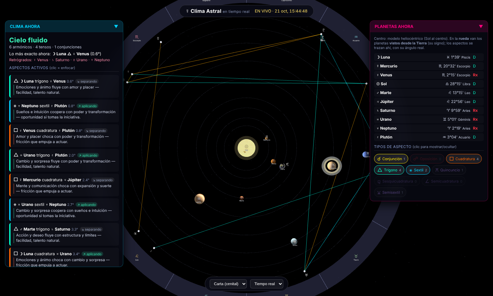

# Clima Astral · en tiempo real

Modelo **heliocéntrico** del sistema solar (Sol al centro) en 3D, con los
planetas texturizados (imágenes de la NASA) orbitando en vivo y la Luna
orbitando la Tierra. Encima, el **clima astrológico**: calcula los **aspectos**
(conjunciones, sextiles, cuadraturas, trígonos, oposiciones y menores) que
forman los planetas **vistos desde la Tierra** (geocéntrico), en tiempo real.

**Sin carta natal, sin fechas, sin formularios.** Solo abres y ves el clima.

> El **modelo 3D** es heliocéntrico (como el de la NASA): el Sol va al centro y
> los planetas giran a su alrededor. En la **rueda exterior** se marcan los
> planetas *vistos desde la Tierra* (su signo), y las **líneas de aspecto se
> trazan entre esos marcadores**, así que muestran el ángulo astrológico real
> (un trígono se ve a 120°, como en una carta). Así conviven el sistema solar
> real y la lectura astrológica, cada uno en su marco.



## Cómo usarlo

Se publica como sitio estático. En **GitHub Pages** (o cualquier servidor) abre
`clima/`. Al abrir muestra el cielo actual y se actualiza en vivo.

- **Arrastra** para orbitar, **rueda** para acercar.
- **Pasa el cursor** por un planeta para ver su signo, grado y palabra clave.
- **Haz clic** en un planeta (o en una tarjeta de aspecto) para **enfocar**: se
  resaltan solo sus aspectos y se atenúa el resto (adiós a la maraña de líneas).
- Cambia la **cámara** (cenital / 3D) y la **velocidad** (tiempo real o acelerado
  para ver el movimiento).

> Las texturas se cargan por `http(s)`; abriendo el archivo directamente
> (`file://`) WebGL las bloquea y se ven colores de respaldo. En Pages o en el
> Artifact se ven completas.

## Qué muestra

- **Clima ahora**: un titular (*Cielo fluido / tenso / mixto*), el conteo de
  aspectos armónicos vs. tensos, el aspecto más exacto del momento y los
  planetas retrógrados.
- **Aspectos activos**: lista ordenada por exactitud, cada uno con su **frase
  clave** y si es **aplicando** (se forma) o **separando** (se va).
- **Planetas ahora**: signo, grado y estado (directo/retro) de cada planeta.
- **Tipos de aspecto**: chips para mostrar/ocultar cada tipo.

## Estructura

```
index.html · css/style.css
js/astro.js   posiciones geocéntricas (clima) y heliocéntricas (modelo) + aspectos
js/data.js    signos, planetas y frases clave del clima
js/scene.js   escena 3D heliocéntrica (Three.js): Sol centro, planetas, Luna, aspectos
js/app.js     bucle en tiempo real, clima, paneles e interacción
assets/       texturas de planetas (imágenes derivadas de la NASA)
../vendor/    Three.js, OrbitControls y Astronomy Engine (compartidos)
```

## Créditos de las texturas

Mapas equirectangulares de los planetas derivados de imágenes de la **NASA /
JPL / Voyager / Cassini** (Tierra: *NASA SVS Blue Marble*). De uso libre.
Motor astronómico: [Astronomy Engine](https://github.com/cosinekitty/astronomy).
